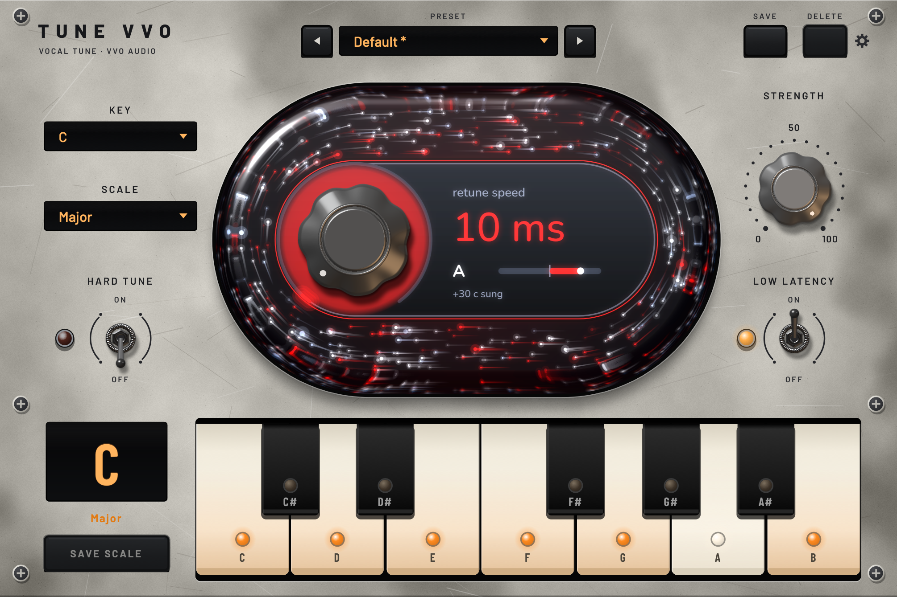

# TUNE VVO (Português)

*[Read in English ↓](#tune-vvo-english)*

**Correção de afinação vocal gratuita, da VVO Audio** — afinação natural e transparente, com o som do padrão de estúdio, e um modo hard-tune para quando você quiser o efeito.

**[⬇ Baixar a versão mais recente](https://github.com/vvoaudio/tunevvo-releases/releases/latest)**

| | macOS Tahoe | macOS Universal | Windows |
|---|---|---|---|
| Arquivo | `TuneVVO-<versão>-macOS.pkg` | `TuneVVO-<versão>-macOS-Universal.pkg` | `TuneVVO-<versão>-Windows-Setup.exe` |
| Requisito | macOS 26 Tahoe ou posterior | macOS 11 Big Sur ou posterior | Windows 10 ou posterior · 64 bits |
| Macs | Apple Silicon (M1 e posteriores) ou Intel | Apple Silicon (M1 e posteriores) ou Intel | — |
| Formato | VST3 + Audio Unit (AU) | VST3 + Audio Unit (AU) | VST3 |
| Instala em | `/Library/Audio/Plug-Ins/VST3/` e `/Library/Audio/Plug-Ins/Components/` | igual | `C:\Program Files\Common Files\VST3\` |

**Qual arquivo para Mac?** No macOS 26 Tahoe, qualquer um dos dois funciona. Em versões mais antigas (Big Sur 11, Monterey 12, Ventura 13, Sonoma 14, Sequoia 15), use o arquivo **Universal**.
O som é idêntico — é o mesmo plugin, compilado para rodar em macOS mais antigos. Ele também está na pasta [`macOS-Universal`](macOS-Universal/) desta página.

## Instalar no Mac
1. Baixe o `.pkg` (Universal, se o seu Mac for anterior ao macOS 26 Tahoe) na [versão mais recente](https://github.com/vvoaudio/tunevvo-releases/releases/latest) e dê dois cliques nele.
2. O macOS vai avisar que não consegue verificar o desenvolvedor (o TUNE VVO é gratuito e não está registrado na Apple). Clique em **Concluído** e abra
   **Ajustes do Sistema → Privacidade e Segurança** (em inglês: **System Settings → Privacy & Security**), role até o fim e clique em **Abrir Mesmo Assim** (**Open Anyway**) ao lado da mensagem do TuneVVO. Confirme com a sua senha.
3. Siga o instalador (ele pede a senha de administrador).
4. Reinicie a sua DAW ou procure plugins novamente (rescan) e carregue o **TUNE VVO** entre os plugins VST3 ou Audio Unit (o Logic e o GarageBand usam o Audio Unit).

## Instalar no Windows
1. Baixe o `.exe` na [versão mais recente](https://github.com/vvoaudio/tunevvo-releases/releases/latest) e execute-o.
2. Se o Windows mostrar **"O Windows protegeu seu computador"**, clique em **Mais informações → Executar mesmo assim** (**More info → Run anyway**). O TUNE VVO é gratuito e não tem assinatura de código.
3. Siga o instalador (ele pede permissão de administrador).
4. Reinicie a sua DAW ou procure plugins novamente (rescan) e carregue o **TUNE VVO** entre os plugins VST3.

## Atualizando
Já tem o TUNE VVO (ou o nome antigo, VvoTune)? Feche a sua DAW e execute o novo instalador da mesma forma. Ele substitui a versão antiga
(inclusive uma cópia antiga na sua pasta pessoal de plugins) e mantém os seus presets, as escalas salvas e os projetos:
as sessões abrem com os mesmos ajustes e o mesmo som.

### Aviso de atualização (a partir da versão que o inclui)
Uma vez por dia o TUNE VVO pergunta ao GitHub qual é a versão mais recente (uma única requisição a `api.github.com`; nada mais é enviado). Se existir uma versão nova,
aparece o botão **UPDATE AVAILABLE!** no alto da janela. Clique nele: o instalador do seu sistema é baixado, conferido com o checksum
SHA-256 publicado e aberto. Feche a sua DAW e conclua o instalador, como acima. Nada é instalado sem você.
Para desligar a verificação, clique com o botão direito no botão e escolha **Turn off update checks** (ou crie um arquivo vazio chamado `update-checks-off` em
`~/Library/Application Support/VvoTune/` no Mac, ou `%APPDATA%\VvoTune\` no Windows). Apague esse arquivo para religar a verificação.

## Guia rápido
- **Key / Scale** — escolha a tonalidade e a escala da música, ou clique no teclado para ligar e desligar notas (adicione notas fora da escala, retire notas dela). **Save Scale** guarda os seus próprios conjuntos de notas.
- **Retune Speed** — a velocidade com que as notas são puxadas para a afinação. 0–20 ms: seca, efeito hard-tune; 20–100 ms: natural; 100–400 ms: suave, com o vibrato preservado. A cor do anel mostra o quanto o plugin está trabalhando.
- **Strength** — quanto da correção é aplicada (0 % = sem correção).
- **Hard Tune** — segura a nota mesmo com vibrato largo, para um efeito robótico mais firme e plano. Desligado = trocas de nota naturais.
- **Low Latency** — cerca de 3 ms de atraso, para gravar monitorando pelo plugin (modo normal: 15 ms, totalmente compensado pela sua DAW).
- **Presets** — **Save Preset** guarda Retune, Strength, Hard Tune, Low Latency e a escala (não a tonalidade). O preset **Default** está sempre disponível.
- **Settings (engrenagem, canto superior direito)** — **Theme**: escolha **Dark** (o painel preto original do rack) ou **Light** (prata envelhecida). **Particle animation**: desmarque para tirar todas as partículas do vidro e manter o uso de CPU baixo; marcada, as partículas se movem na taxa de atualização do seu monitor, em sincronia com a tela. As duas escolhas ficam salvas.

## Desinstalar
- **Mac:** apague `/Library/Audio/Plug-Ins/VST3/TuneVVO.vst3` e `/Library/Audio/Plug-Ins/Components/TuneVVO.component`.
- **Windows:** Configurações → Aplicativos → **TUNE VVO (VST3)** → Desinstalar.

Os presets e as escalas salvas ficam em `~/Library/Application Support/VvoTune` (Mac) ou `%APPDATA%\VvoTune` (Windows).

---
O TUNE VVO é gratuito para uso pessoal e fornecido no estado em que se encontra, sem garantia. VST é uma marca registrada da Steinberg Media Technologies GmbH.
Licenças de terceiros: veja [THIRD_PARTY_NOTICES.txt](THIRD_PARTY_NOTICES.txt).

---

# TUNE VVO (English)

*[Ler em português ↑](#tune-vvo-português)*

**Free vocal pitch correction by VVO Audio** — natural, transparent tuning that sounds like the studio standard, with a hard-tune mode when you want the effect.

**[⬇ Download the latest version](https://github.com/vvoaudio/tunevvo-releases/releases/latest)**

| | macOS Tahoe | macOS Universal | Windows |
|---|---|---|---|
| File | `TuneVVO-<version>-macOS.pkg` | `TuneVVO-<version>-macOS-Universal.pkg` | `TuneVVO-<version>-Windows-Setup.exe` |
| Needs | macOS 26 Tahoe or later | macOS 11 Big Sur or later | Windows 10 or later · 64-bit |
| Macs | Apple Silicon (M1 and later) or Intel | Apple Silicon (M1 and later) or Intel | — |
| Format | VST3 + Audio Unit (AU) | VST3 + Audio Unit (AU) | VST3 |
| Installs to | `/Library/Audio/Plug-Ins/VST3/` and `/Library/Audio/Plug-Ins/Components/` | same | `C:\Program Files\Common Files\VST3\` |

**Which Mac file?** On macOS 26 Tahoe either one works. On anything older (Big Sur 11, Monterey 12, Ventura 13, Sonoma 14, Sequoia 15) use the **Universal** file.
It sounds identical — same plug-in, built to run on older macOS. It is also in the [`macOS-Universal`](macOS-Universal/) folder of this page.

## Install on Mac
1. Download the `.pkg` (Universal if your Mac is older than macOS 26 Tahoe) from the [latest release](https://github.com/vvoaudio/tunevvo-releases/releases/latest) and double-click it.
2. macOS will say it can't verify the developer (TUNE VVO is free and not registered with Apple). Click **Done**, then open
   **System Settings → Privacy & Security**, scroll down and click **Open Anyway** next to the TuneVVO message. Confirm with your password.
3. Click through the installer (it asks for your administrator password).
4. Restart your DAW or rescan plug-ins, and load **TUNE VVO** from your VST3 or Audio Unit plug-ins (Logic and GarageBand use the Audio Unit).

## Install on Windows
1. Download the `.exe` from the [latest release](https://github.com/vvoaudio/tunevvo-releases/releases/latest) and run it.
2. If Windows shows **"Windows protected your PC"**, click **More info → Run anyway** (TUNE VVO is free and not code-signed).
3. Click through the installer (it asks for administrator permission).
4. Restart your DAW or rescan plug-ins, and load **TUNE VVO** from your VST3 plug-ins.

## Updating
Already have TUNE VVO (or its earlier name, VvoTune)? Quit your DAW, then run the new installer the same way. It replaces the old version
(including any older copy in your own plug-in folder), and keeps your presets, saved scales and projects:
sessions open with the same settings and the same sound.

### Update notice (from the version that includes it)
Once a day TUNE VVO asks GitHub which version is the latest (one request to `api.github.com`; nothing else is sent). If a newer one exists, an
**UPDATE AVAILABLE!** button appears at the top of the window. Click it: the installer for your system is downloaded, checked against the published
SHA-256 checksum and opened. Quit your DAW and finish the installer, as above. Nothing is installed without you.
To turn the check off, right-click the button and choose **Turn off update checks** (or create an empty file named `update-checks-off` in
`~/Library/Application Support/VvoTune/` on Mac, `%APPDATA%\VvoTune\` on Windows). Delete that file to turn it back on.

## Quick guide
- **Key / Scale** — choose the song's key and scale, or click the keyboard to switch notes on and off (add notes outside the scale, remove notes from it). **Save Scale** keeps your own note sets.
- **Retune Speed** — how fast notes are pulled to pitch. 0–20 ms: tight, hard-tune; 20–100 ms: natural; 100–400 ms: gentle, vibrato kept. The ring colour shows how hard it is working.
- **Strength** — how much correction is applied (0 % = untouched).
- **Hard Tune** — holds the note even through wide vibrato for a steadier, flatter robotic effect. Off = natural note changes.
- **Low Latency** — about 3 ms delay for recording while monitoring through the plug-in (normal mode: 15 ms, fully compensated by your DAW).
- **Presets** — **Save Preset** stores Retune, Strength, Hard Tune, Low Latency and the scale (not the key). **Default** is always available.
- **Settings (gear, top right)** — **Theme**: choose **Dark** (the original black rack faceplate) or **Light** (weathered silver). **Particle animation**: untick it to remove all particles from the glass and keep CPU use low; ticked, the particles move at your monitor's refresh rate, in step with the screen. Both choices are remembered.

## Uninstall
- **Mac:** delete `/Library/Audio/Plug-Ins/VST3/TuneVVO.vst3` and `/Library/Audio/Plug-Ins/Components/TuneVVO.component`.
- **Windows:** Settings → Apps → **TUNE VVO (VST3)** → Uninstall.

Presets and saved scales live in `~/Library/Application Support/VvoTune` (Mac) or `%APPDATA%\VvoTune` (Windows).

---
TUNE VVO is free for personal use and provided as is, without warranty. VST is a trademark of Steinberg Media Technologies GmbH.
Third-party licences: see [THIRD_PARTY_NOTICES.txt](THIRD_PARTY_NOTICES.txt).
